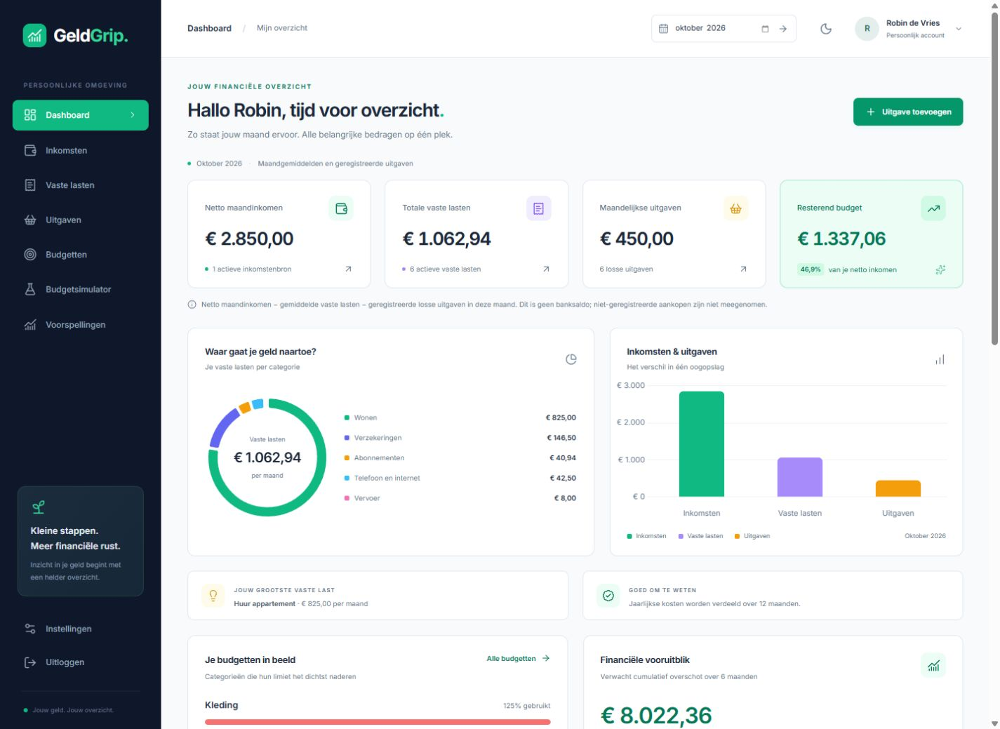
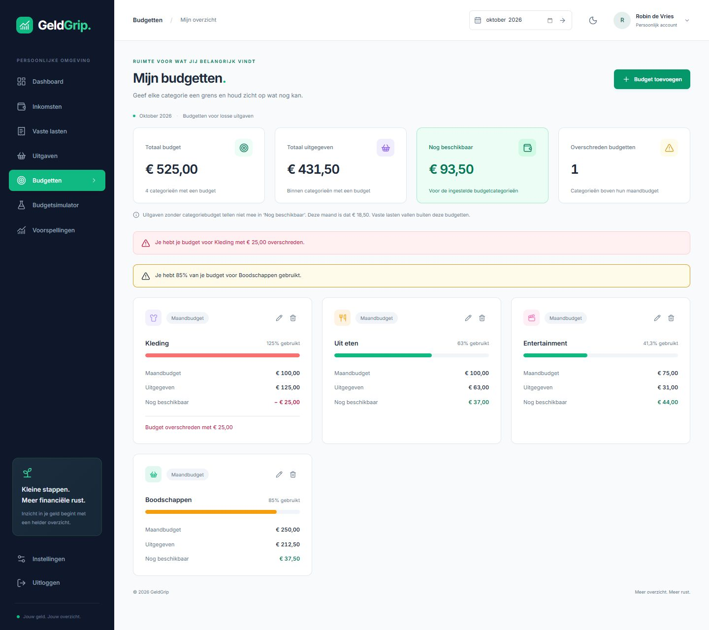
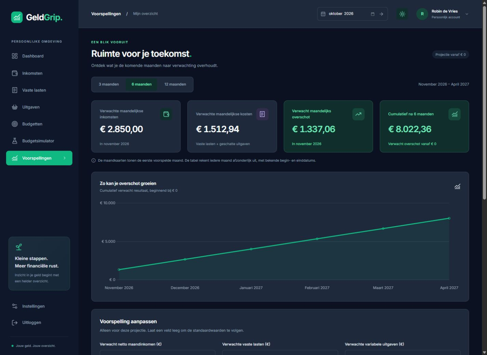
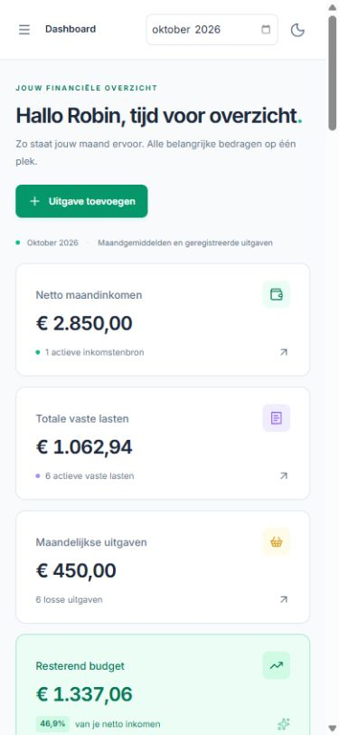
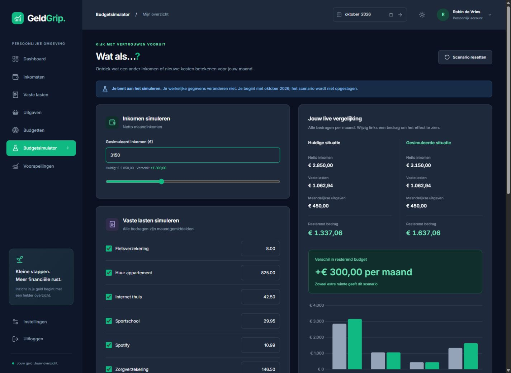

# GeldGrip

Persoonlijk financieel dashboard. Je houdt je netto-inkomen, vaste lasten en losse uitgaven bij, stelt categoriebudgetten in en kijkt vooruit met financiële voorspellingen. De schermafbeeldingen hieronder tonen de actuele applicatie met uitsluitend fictieve gegevens.

## Schermafbeeldingen

### Dashboard

Netto maandinkomen, vaste lasten, losse uitgaven en wat er overblijft, plus een verdeling per categorie. Lager op de pagina staan je budgetten en financiële vooruitblik.



### Budgetten per categorie

Stel per maand je eigen budgetten in. De voortgangsbalken en waarschuwingen laten zien welke categorieën hun limiet naderen of overschrijden.



### Financiële voorspellingen

Bekijk je verwachte cumulatieve overschot over 3, 6 of 12 maanden. Je kunt de aannames tijdelijk aanpassen. Bekende begin- en einddatums tellen standaard mee; de projectie is geen banksaldo.



### Op je telefoon

Hetzelfde overzicht op een smal scherm, met het menu dicht.



### Budgetsimulator

Probeer een ander inkomen of extra lasten uit. Je opgeslagen gegevens blijven staan.



## Wat je ermee kunt

- Een account aanmaken, inloggen, uitloggen, ingelogd blijven en je wachtwoord herstellen.
- Meerdere inkomstenbronnen bijhouden.
- Vaste lasten beheren met categorie, frequentie, betaaldag en een begin- en einddatum.
- Losse uitgaven per maand bijhouden, met categorie, zoeken en sorteren.
- Per categorie en maand een budget instellen, met voortgang, waarschuwingen en overnemen van de vorige maand.
- Verwachte overschotten over 3, 6 en 12 maanden bekijken, met instelbare aannames en begin- en einddatums.
- Per maand zien wat er overblijft, met een categorieoverzicht en een vergelijking.
- Een budget uitproberen met ander inkomen of extra lasten, zonder je opgeslagen gegevens te wijzigen.
- Wisselen tussen een lichte, donkere of systeemweergave.
- Zoeken, filteren, en je profiel of wachtwoord wijzigen. Je account verwijderen haalt ook de financiële gegevens weg.

## Techniek

Laravel 13, Blade, Tailwind CSS, Chart.js, SQLite en PHPUnit. Lokaal gaat e-mail naar `storage/logs/laravel.log`.

## Clonen en starten

Je hebt Git, PHP 8.3 of nieuwer, [Composer](https://getcomposer.org) en [Node.js](https://nodejs.org) 22.12 of nieuwer nodig.

```bash
git clone https://github.com/John07-Coder/GeldGrip.git
cd GeldGrip
composer run setup
php artisan serve
```

`composer run setup` maakt `.env`, de applicatiesleutel, `database/database.sqlite`, de migraties en de frontend. Open daarna [http://127.0.0.1:8000](http://127.0.0.1:8000) en registreer een account. Een nieuw account begint leeg.

Tijdens het ontwikkelen kun je `composer run dev` gebruiken. Dat start Laravel en Vite samen.

Een herstellink komt lokaal in `storage/logs/laravel.log`, omdat `MAIL_MAILER=log` staat. Voor echte e-mail zet je in `.env` de SMTP-gegevens en voer je `php artisan config:clear` uit.

### Voorbeeldgegevens

Alleen als `APP_ENV=local` kun je een demoaccount vullen. Kies zelf een wachtwoord. Er staat geen standaardwachtwoord in de code.

```bash
DEMO_PASSWORD='kies-een-eigen-wachtwoord' php artisan db:seed --class=DemoSeeder
```

Log in met `demo@example.test` en het gekozen wachtwoord. De schermafbeeldingen in deze repository zijn gemaakt met fictieve gegevens.

## Tests

```bash
php artisan test
npm test
npm run build
```

De suite controleert ook dubbele budgetten, maandgrenzen, gebruikersisolatie, prognoses en tijdelijke aannames. Zie [de implementatie en verificatie](docs/BUDGETTEN-EN-VOORSPELLINGEN.md) voor de rekenregels en uitgevoerde controles.

## Beveiliging

- Je ziet alleen je eigen inkomsten, lasten, uitgaven en budgetten. Een id van iemand anders levert 404 op. Voorspellingen gebruiken uitsluitend je eigen gegevens.
- De client kan geen `user_id` meesturen. Laravel verzorgt de sessie, de wachtwoordhash en CSRF.
- Inloggen, registreren en wachtwoordherstel zijn beperkt in aantal pogingen per minuut.
